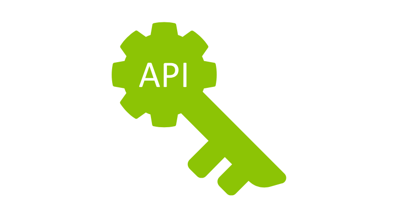

#

## What are API Keys

API Keys are an authentication mechanism used to identify and authorize users or applications accessing an API, without using a user name and password. 
The key itself is simply a long string of characters and each one is unique to each Granite user. 
Here is an example of what a Granite API Key can look like: `TsIPsMSGzqYDjwTc-bd2CtrGU7FHwydPeuZ7ruA1DpPnzr7R3Swk8o_Nlkwd5Bty`

## Why do we need API Keys in Granite V6
Mainly, its because of the stricter security requirements on our new APIs.  
API Keys allow V6 SQLCLR procedures to connect securely to our APIs without needing the user's password.
API keys also provider a better experience for third parties using our APIs by providing a straightforward way to authenticate and authorize their requests.


## Which APIs support API keys

As of Granite version 7, the following APIs and services accept API keys:

- Business API
- Custodian API
- Integration Service
- Label Print services (ZPL and Bartender)
- Sage Intacct Integration Service
- Parcel Perfect Service

The Scheduler does not accept API keys.

!!! note
    SQLCLR uses API keys for every call that it makes to these services. This means that:

    - every user that prints labels using `clr_PrintLabel` needs an API key
    - the user that is passed as `@userName` to the `clr_Integration...` procedures needs an API key

    If the user has no API key, the procedure will fail with `ApiKey not found for user`.

## How do I get an API key

API keys are automatically generated for Granite users whenever their password is saved. 
There is no way currently to view these API keys from the front end - you will need to fetch the API key out of the `UsersCredential` table in the Granite database.

!!! note 
    If you change your Granite user password, your API key will also change. 
    This is useful if an API key leaks and you need to invalidate the old one and regenerate a new one.

## How do I use an API key

You can use your API key to access the Granite APIs by passing it in the `X-Api-Key` HTTP header like this:

```http
GET /resource HTTP/1.1
Host: server.example.com
X-Api-Key: TsIPsMSGzqYDjwTc-bd2CtrGU7FHwydPeuZ7ruA1DpPnzr7R3Swk8o_Nlkwd5Bty
```

API keys must always be sent over `https`.

!!! warning "Changed in version 7"
    Before version 7 the API key was passed as an `Authorization: Bearer` token. This is no longer accepted - the API key is only read from the `X-Api-Key` header.
    Any scripts or third party applications that use an API key need to be changed when upgrading. See the [Authentication & HTTPS Upgrade Guide](../updates/V7/auth-https-upgrade.md).

    The `Authorization: Bearer` header is now reserved for the login token that the Business API issues to the ProcessApp.

## The AUTOMATION user's API key

The Scheduler uses the API key of the `AUTOMATION` user to send emails via the Custodian API.
When the Scheduler starts up it will create the `AUTOMATION` user if it does not exist, and generate an API key for it if it does not have one.
The user is created without a usable password, so it can only be used with its API key.