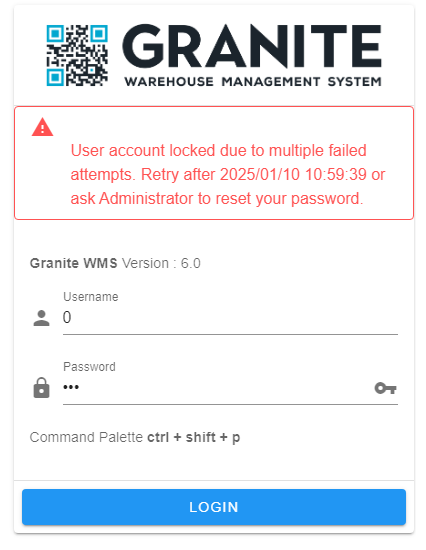
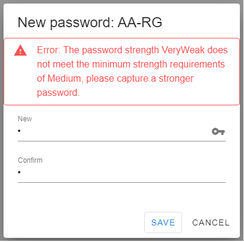

# Security settings 

The following settings are optional and related to Granite security. Configuration is managed within the SystemSettings database table.

Important Notes:
- Each setting is activated by the isActive value in the table.
- The Value field is used to configure the specific parameters for each setting.
- Once a security policy is breached, the **UsersCredential** table will be updated to enforce the policy.

### PasswordFailedAttempts

- Description: Defines the maximum number of failed login attempts allowed before a user account is locked.
- Configuration: Specify the number of failed attempts as the Value.
- Scope: Failed attempts are counted when logging in through the Process App, the Business API and the Scheduler. The Custodian API refuses a locked account, but does not count failed attempts.
- Unlocking: If PasswordRecoveryMinutes is not active, a locked account stays locked until an administrator resets the user's password.

### PasswordRecoveryMinutes

- Description: Sets how long a locked account stays locked (in minutes). The failed attempt counter is only reset by a successful login or a password reset.
- Dependency: This setting only takes effect if PasswordFailedAttempts is active.
- Configuration: Specify the recovery duration (in minutes) as the Value.
- Limitation: The lock period is only set once. Further failed attempts after it has passed do not start a new lock period.

### EnablePasswordStrength

- Description: Enforces a strong password policy for all new passwords while retaining previous passwords.
- Configuration: when active set the Value to one of the options below ranging from 1 to 5.
  
| Value | Name       | Description                                                                 |
|-------|------------|-----------------------------------------------------------------------------|
| 1     | VeryWeak   | Minimum 4 characters with at least 1 unique character. No digits, lowercase, uppercase, or special characters required. |
| 2     | Weak       | Minimum 8 characters with at least 2 unique characters. Must include digits and lowercase letters. Uppercase and special characters are not required. |
| 3     | Medium     | Minimum 12 characters with at least 3 unique characters. Must include digits, lowercase, and uppercase letters. Special characters are not required. |
| 4     | Strong     | Minimum 14 characters with at least 4 unique characters. Must include digits, lowercase, uppercase, and special characters. |
| 5     | VeryStrong | Minimum 16 characters with at least 5 unique characters. Must include digits, lowercase, uppercase, and special characters.   |

### EnablePasswordExpiry

- Description: Activates password expiration, requiring users to update their passwords after a set period.
- Configuration: Specify the expiration period (in days) as the Value.
- Existing passwords: The expiry date is set when a password is saved. Passwords saved before this setting was activated do not expire until they are next saved.

### JwtAuthKey

- Description: The key that is used to sign and verify the login tokens that are shared by the Granite services. The Business API issues a token when a user logs in, and the ProcessApp passes it on to the Integration Service and Label Print service.
- Configuration: The value is generated by the database create and upgrade scripts, and is unique to each database. It does not need to be configured.

!!! warning
    - Do not change or remove this setting. Changing the value logs every user out and invalidates every token that has been issued.
    - All Granite services must connect to the **same database** so that they use the same key. A service that is connected to a different database will reject the tokens issued by the Business API with a `401 Unauthorized`.
    - Tokens are only accepted over `https`.

----

` Examples of application handling security breaches`

----

